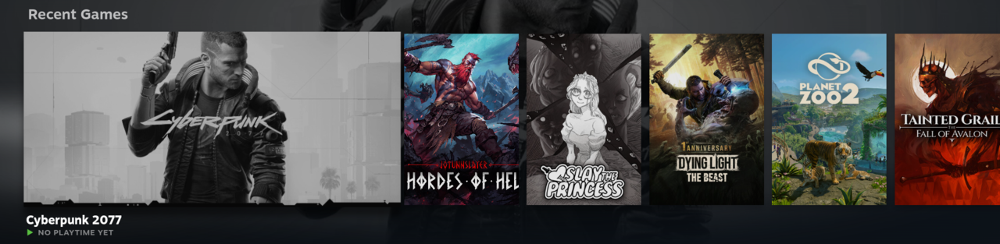
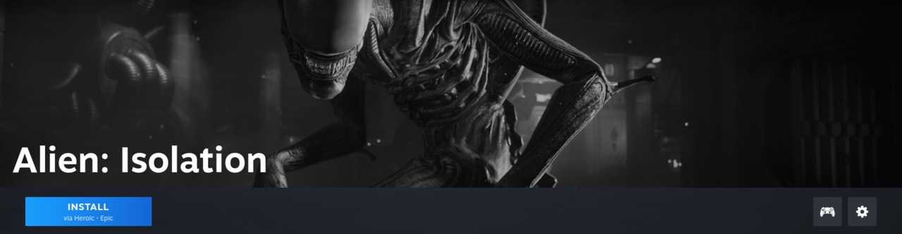
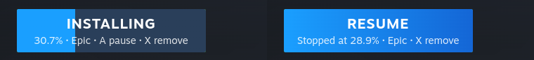
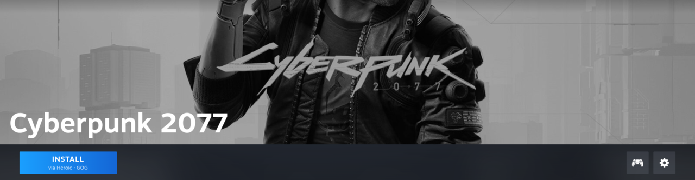
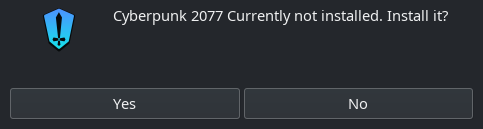

# steam-heroic-library

[](LICENSE)


> **Disclaimer:** vibe-coded for my own machine. Personal use, no support,
> no guarantees - read the code before you run it.

Your Epic and GOG games (through [Heroic](https://heroicgameslauncher.com)) in the Steam
library on Linux, looking and behaving like Steam games:

- **Every owned game, installed or not**, as a Steam shortcut with the store's cover,
  hero and icon art. Not-installed games get grey art.
- **Genre collections** in Steam for your Heroic *and* Steam games, from a list you curate,
  with [Jev](https://docs.typesafe.ai) (optional) sorting whatever the list does not cover.
- **An Install button in Steam** (Millennium plugin): it replaces Play on games that are
  not installed. Epic games download straight away with progress on the button, ⏸ to pause,
  Resume, and ✕ to remove. Not-installed games show greyed out in the library list, like
  Steam's own.

Everything syncs when Steam starts, so new purchases show up on the next launch. It works in
the desktop client and in Game Mode (Bazzite, gamescope-session).

## Screenshots

Game Mode on Bazzite. Epic and GOG games sit next to Steam games; Cyberpunk 2077 (GOG, not
installed) has grey art, Jotunnslayer (Epic, installed) has full color:



An Epic game that is not installed: Install replaces Play and downloads it directly.



Download progress on the button, then Resume after a pause:



A GOG game opens Heroic's install prompt:




## Requirements

- Linux with native Steam (not Flatpak) at `/usr/bin/steam`
- Heroic installed natively (not Flatpak) as `heroic` on `PATH` or `~/.local/bin/heroic`,
  logged in to Epic and/or GOG. Its bundled legendary is found next to the resolved
  binary (AUR `heroic-games-launcher-bin`, or the release `.tar.xz` unpacked anywhere);
  set `HEROIC_BIN` and `HEROIC_LEGENDARY` to override
- Python 3.10+, ImageMagick (`magick`), `jq`, `notify-send`
- For the Install button: [Millennium](https://steambrew.app) 3.4+ and [Bun](https://bun.com)
- For Jev sorting (optional): a [TypeSafe](https://console.typesafe.ai/keys) API key

## Install

```bash
git clone https://github.com/WSeubring/steam-heroic-library
cd steam-heroic-library
./install.sh
```

`install.sh` links the scripts into `~/.local/bin`, makes Steam's launcher run the sync
first, creates `~/.config/heroic-steam-sync/categories.json` from the example, and builds
the plugin when Bun and Millennium are present. Then enable **Heroic Install** in
Steam → Millennium → Plugins and fully quit and restart Steam.

### Bazzite (and other image-based systems)

`/usr` and `/opt` are read-only, so install everything in your home directory:

- **Heroic**: unpack the release `Heroic-*-linux-x64.tar.xz` to `~/.local/opt/Heroic` and
  link `~/.local/bin/heroic` to `~/.local/opt/Heroic/heroic`.
- **Millennium**: unpack the release tarball's `usr/lib/millennium` to
  `~/.local/lib/millennium`, set
  `MILLENNIUM_RUNTIME_PATH=${HOME}/.local/lib/millennium/libmillennium_x86.so` in
  `~/.config/environment.d/millennium.conf`, and create the three symlinks the official
  installer makes in `~/.local/share/Steam/ubuntu12_32` and `ubuntu12_64`, pointing into
  `~/.local/lib/millennium`.

`install.sh` also hooks Game Mode: it writes
`~/.config/gamescope-session-plus/sessions.d/steam` and `ogui-steam`, so the session runs the sync before it
starts Steam. Desktop mode keeps Bazzite's `bazzite-steam` wrapper (`$HEROIC_STEAM`).

## How it works

| Piece | What it does |
|---|---|
| `bin/heroic-steam-sync` | Reads Heroic's library, writes Steam's `shortcuts.vdf`, grid art and collections. Runs before Steam starts, because Steam only reads shortcuts at startup and overwrites them on exit. |
| `bin/heroic-steam-launch` | Target of every shortcut: installed games launch through Heroic, others open Heroic's install prompt. |
| `plugin/` | Millennium plugin: the Install button, progress and the greyed-out list rows. |
| `~/.local/share/applications/steam.desktop` | Override that runs `heroic-steam-sync --launch-steam` instead of plain Steam. |
| `~/.config/gamescope-session-plus/sessions.d/{steam,ogui-steam}` | Same for Game Mode (gamescope-session-plus, as on Bazzite). |

The sync only touches shortcuts it created and collections whose id starts with `uc-hss-`;
your other shortcuts and collections stay as they are.

## Categories

`~/.config/heroic-steam-sync/categories.json` maps collection names to game titles (Steam,
Epic or GOG; matching ignores case and punctuation). It always wins over Jev. Edit it and
restart Steam to apply.

With a Jev key, games not in the file are sorted into the same collections and cached in
`~/.cache/heroic-steam-sync/jev.json`, so each game is classified once (a few hundred tokens,
a fraction of a cent). The key comes from `$TYPESAFE_API_KEY`, or from a Bitwarden item via
[rbw](https://github.com/doy/rbw) (`$JEV_SECRET`, default `TypeSafe Jev API`). On Steam
startup it never prompts: a locked vault just means new games wait until the next start.
Run `heroic-steam-sync --classify` with Steam closed to sort everything at once.

## Installing from Steam

- **Epic**: Install downloads directly with Heroic's bundled legendary into Heroic's default
  install folder, so Heroic sees the game as installed afterwards. Progress is size on disk
  over install size, so it stays right across pause and resume. ✕ asks for a second click,
  then deletes the partial download.
- **GOG**: Install opens Heroic's install prompt, because Heroic only registers GOG installs
  it ran itself.
- **Game Mode**: the install state is drawn over Steam's own Play button, so it keeps
  controller focus. For Epic, A installs, pauses or resumes; X twice (within 4 seconds)
  removes a started install. For GOG, A opens Heroic's install prompt through Steam's own
  Play, because Game Mode only shows windows of apps Steam launched.

## Notes

- Millennium injects into the Steam client. Steam updates can break it (and this plugin)
  until they catch up; I know of no VAC bans from it, but it is your call.
- Plugin frontends run in an isolated JavaScript world, so the page logic
  (`plugin/frontend/page.ts`) is injected into Steam's main world over Millennium's CDP
  bridge.
- After a rebuild, Millennium hot-reloads the plugin and its Lua backend can die
  (`failed to send RPC to child`): fully restart Steam.

## Development

`tools/dev-loop.sh` runs one round: build the plugin, restart Steam with DevTools on
(localhost:8080), print the plugin's console and backend log for 30 seconds, and report
whether the page script is live. `tools/devtools.py eval '<js>'` evaluates in Steam's main
world while DevTools is up.
